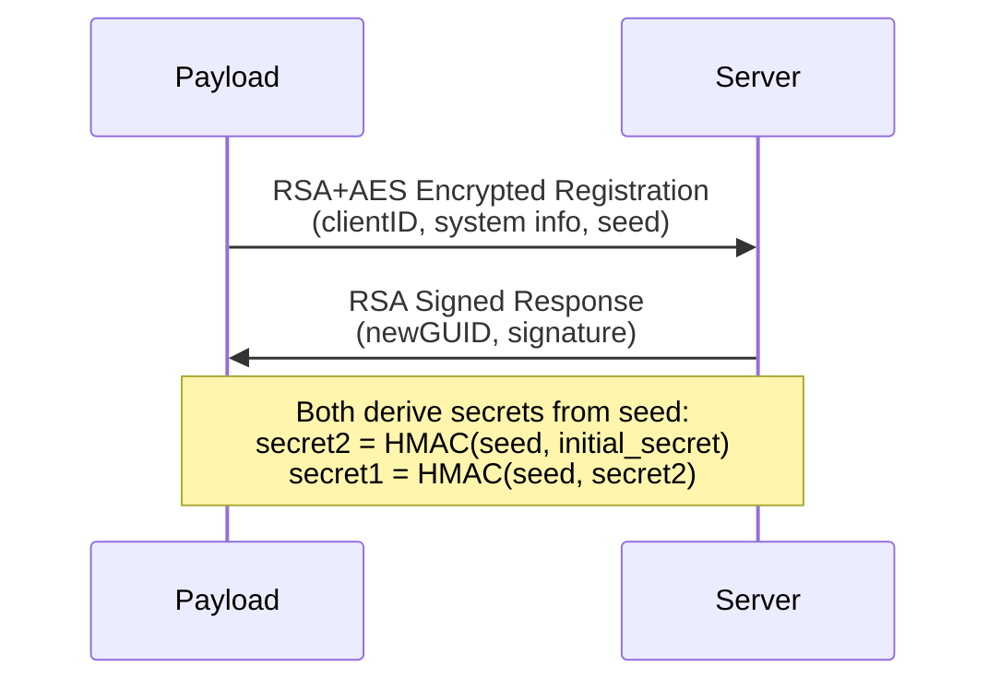
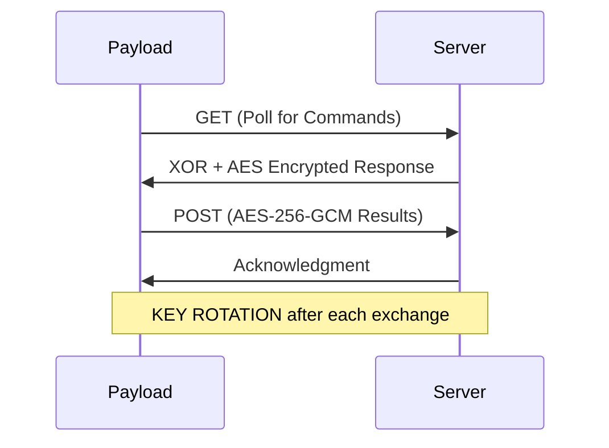

# Encryption & Communication Protocol

## Overview

NexusC2 implements a multi-layer encryption scheme for secure communication between payloads (agents) and the server. The protocol uses industry-standard cryptographic algorithms with automatic key rotation to maintain forward secrecy.

**Key Features:**
- Hybrid RSA + AES encryption for initial handshake
- AES-256-GCM for ongoing communication
- Automatic key rotation after each exchange
- Automatic re-keying on desynchronization

---

## Architecture

### Initial Handshake



### Ongoing Communication



---

## Initial Handshake

### Step 1: Payload Registration

The payload initiates contact using **hybrid encryption** (RSA-2048 + AES-256-GCM):

1. **Generate AES Key**: Random 32-byte key for this message
2. **Encrypt Data**: JSON payload encrypted with AES-256-GCM
3. **Encrypt AES Key**: The AES key encrypted with server's RSA public key (OAEP-SHA256)
4. **Send**: Both encrypted components sent to server

**Registration Payload Structure:**
```json
{
  "ag": {
    "cl": "initial-client-id-from-build",
    "seed": "random-seed-for-key-derivation",
    "ip": "internal IP",
    "un": "current user",
    "hn": "machine name",
    "pn": "process name",
    "pid": 1234,
    "ac": "amd64",
    "os": "windows"
  },
  "md": {"encryption": "rsa+aes"},
  "st": "register"
}
```

**Wire Format (hybrid encryption wrapper):**
```json
{
  "data": "<hybrid encrypted JSON string>",
  "md": {"encryption": "rsa+aes"},
  "ts": 1705312200
}
```

**Hybrid Encryption Structure (inside `data` field):**
```json
{
  "ek": "<base64 RSA-encrypted AES key>",
  "ed": "<base64 AES-GCM encrypted JSON>"
}
```

### Step 2: Server Response

The server validates the registration and responds:

1. **Verify clientID**: Check against `inits` table (from payload generation)
2. **Generate newGUID**: New UUID becomes the agent's permanent identifier
3. **Derive Secrets**: Generate encryption keys from payload's seed
4. **Sign Response**: RSA-PKCS1v15 signature with SHA-256

**Response Structure:**
```json
{
  "st": "success",
  "nc": "550e8400-e29b-41d4-a716-446655440000",
  "si": true,
  "sg": "<base64 RSA signature>",
  "seed": "<echoed seed for verification>",
  "ct": "<base64 comms template>",
  "et": "<base64 exec requirements template>"
}
```

---

## Secret Derivation

Both payload and server independently derive identical secrets using HMAC-SHA256:

```
Input: seed (from payload), initial_secret (from build)

Step 1: h1 = HMAC-SHA256(seed, initial_secret)
        secret2 = hex(h1)

Step 2: h2 = HMAC-SHA256(seed, secret2)
        secret1 = hex(h2)
```

**Result:**
- `secret1`: Current encryption key (64 hex chars = 256 bits)
- `secret2`: Previous key for rotation (64 hex chars = 256 bits)

---

## Ongoing Communication

### GET Requests (Polling for Commands)

Payloads poll the server for pending commands:

**Request:**
```
GET /poll?id=<clientID>
Headers: User-Agent, custom headers from config
```

**Response Encryption (XOR Layer):**

The server wraps responses in XOR encryption with decoy fields for obfuscation:

1. **Derive XOR Key**: `SHA256(clientID + ":" + secret1)[:32]`
2. **Build JSON**: Server creates a JSON object with 3 random field keys — one holds the real base64-encoded XOR-encrypted data, the other two contain random noise
3. **Client Decryption**: Payload tries decrypting all fields to find the valid one (`tryDecryptResponse`)

**Response Structure (after finding and XOR-decrypting the real field):**
```json
{
  "st": "1",
  "data": "<AES-encrypted command>",
  "lr": [],
  "lc": []
}
```

**Status values:** `"1"` = command ready, `"0"` = no commands

**Command Data (after AES decryption):**

Command field names use short wire format tags defined at build time via malleable profile templates.

### POST Requests (Sending Results)

Payloads send command results using AES-256-GCM:

**Request:**
```
POST /submit?id=<clientID>
Content-Type: application/json
Body: {"data": "<base64 AES-GCM encrypted results>"}
```

**Encryption Process:**
1. `key = SHA256(secret1)` (32 bytes)
2. `nonce = random(12 bytes)`
3. `ciphertext = AES-GCM.Seal(plaintext, nonce)`
4. `output = base64(nonce || ciphertext)`

**Results Structure (plaintext):**

Result field names use short wire format tags (e.g., `co`, `cb`, `ou`, `ec`) defined at build time via malleable profile templates. The exact field names vary per build configuration.

---

## Key Rotation

Keys are automatically rotated after each successful exchange to maintain forward secrecy.

### Rotation Formula

```
newSecret = HMAC-SHA256(secret2, secret1)
secret2 = secret1
secret1 = newSecret
```

### Rotation Timing

| Event | Who Rotates |
|-------|-------------|
| After sending GET response | Server |
| After receiving commands (GET response) | Payload |
| After receiving results (POST request) | Server |
| After sending results (POST request) | Payload |

Both sides rotate after both GET and POST operations, maintaining synchronized key state.

---

## Re-keying Mechanism

If keys become desynchronized (e.g., network failure, crash), the system can re-establish encryption:

### Automatic Re-key

When decryption fails, the payload automatically triggers a re-key:

1. **Detection**: AES-GCM decryption returns error
2. **Flag**: Atomic flag prevents concurrent re-key attempts
3. **Handshake**: Background goroutine performs fresh handshake
4. **Recovery**: New secrets derived, communication resumes

### Manual Re-key

The server can force a re-key via special status (field names are configurable via malleable profile, defaults shown):

```json
{
  "status": "kr",
  "command_db_id": 42
}
```

The payload then performs `refreshHandshake()` to re-establish keys.

---

## Security Summary

| Layer | Algorithm | Key Size | Purpose |
|-------|-----------|----------|---------|
| Handshake Key Exchange | RSA-OAEP-SHA256 | 2048-bit | Protect initial AES key |
| Handshake Data | AES-256-GCM | 256-bit | Encrypt registration data |
| Handshake Signature | RSA-PKCS1v15-SHA256 | 2048-bit | Authenticate server response |
| Secret Derivation | HMAC-SHA256 | 256-bit | Derive symmetric keys |
| Command Encryption | AES-256-GCM | 256-bit | Encrypt commands/results |
| Response Obfuscation | XOR | 256-bit | Lightweight GET response encryption |
| Key Rotation | HMAC-SHA256 | 256-bit | Forward secrecy |

---

## Protocol Security Properties

- **Confidentiality**: All data encrypted with AES-256-GCM
- **Integrity**: GCM mode provides authenticated encryption
- **Authentication**: RSA signatures verify server identity
- **Forward Secrecy**: Key rotation limits exposure from compromise
- **Replay Protection**: Nonces prevent message replay

---

## Configuration

Encryption parameters are set during payload generation:

| Parameter | Description | Location |
|-----------|-------------|----------|
| `PUBLIC_KEY` | RSA public key (base64) | Build environment |
| `SECRET` | Initial secret for derivation | Build environment |
| `XOR_KEY` | Additional obfuscation key | Build environment |

---

## Related Files

| Component | File Path |
|-----------|-----------|
| Payload Encryption | `server/docker/payloads/Linux/encryption.go` |
| Payload Secret Management | `server/docker/payloads/Linux/secure_comms.go` |
| Payload Handshake | `server/docker/payloads/Linux/handshake.go` |
| Server Encryption | `server/internal/agent/listeners/encryption.go` |
| Server Handshake Handler | `server/internal/agent/listeners/handler_handshake.go` |
| Server GET Handler | `server/internal/agent/listeners/handler_get.go` |
| Server POST Handler | `server/internal/agent/listeners/handler_active.go` |
| XOR Implementation | `server/internal/agent/listeners/xor.go` |
