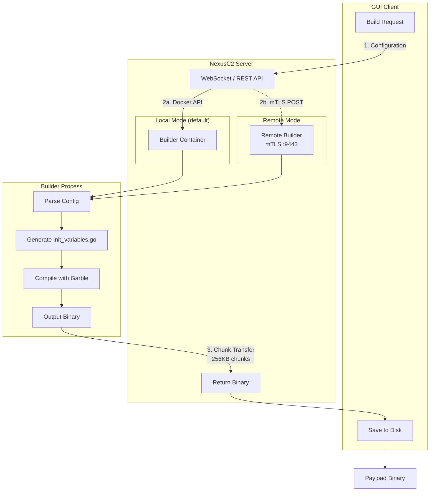

# Payload Generation

## Overview

NexusC2 generates agent payloads using a Docker-based build system that can run locally (default) or on a remote machine via mTLS. Payloads are compiled Go binaries with configurable options for network communication, obfuscation, and anti-analysis features.

**Supported Platforms:**
- Windows (x64, x86)
- Linux (x64, arm64)
- macOS/Darwin (x64, arm64)

**Payload Types:**
- HTTP/HTTPS - Standard web-based communication
- SMB - Named pipe communication for Windows lateral movement
- TCP - Direct TCP socket communication for lateral movement

---

## Architecture



---

## Builder Container

> **Remote mode:** When `mode = "remote"` is set in `config.toml`, no local container is spawned — build requests are sent to the remote builder over mTLS instead. See [Remote Builder](REMOTE-BUILDER.md) for setup.

### Environment

| Property | Value |
|----------|-------|
| Base Image | golang:1.27-alpine |
| Obfuscator | Garble (mvdan.cc/garble v0.17.0) |
| Container Name | builder |

### Build Modes

**Standard Build (`BUILD=TRUE`):**
- Compiles agent with specified configuration
- Applies Garble obfuscation
- Outputs binary to `/shared/{filename}`

**Project Export (`EXPORT_PROJECT=TRUE`):**
- Exports complete source project
- Includes build scripts for manual compilation
- Outputs ZIP file to `/shared/{filename}.zip`

Contents of exported project:
```
app/
├── init_variables.go    # Generated configuration
├── go.mod              # Dependencies
├── go.sum              # Dependency checksums
├── build.sh            # Linux/macOS build script
├── build.bat           # Windows build script (Windows only)
├── Makefile            # Make-based build (if generated)
├── *.go                # All agent source files
└── <subdirs>/          # Platform-specific packages
```

---

## Configuration Options

### Network Configuration

| Variable | Description | Example |
|----------|-------------|---------|
| `PROTOCOL` | HTTP or HTTPS | `https` |
| `IP` | C2 server address | `192.168.1.100` |
| `PORT` | C2 server port | `443` |
| `GET_ROUTE` | Polling endpoint | `/api/v1/poll` |
| `POST_ROUTE` | Results endpoint | `/api/v1/submit` |

### HTTP Configuration

| Variable | Description | Example |
|----------|-------------|---------|
| `USER_AGENT` | HTTP User-Agent header | `Mozilla/5.0...` |
| `CONTENT_TYPE` | Content-Type header | `application/json` |
| `CUSTOM_HEADERS` | Additional headers (JSON) | `{"X-Custom":"value"}` |
| `GET_CLIENT_ID_NAME` | Query param name for GET | `id` |
| `POST_CLIENT_ID_NAME` | Query param name for POST | `id` |

### HTTP Methods

| Variable | Description | Default |
|----------|-------------|---------|
| `GET_METHOD` | Method for polling | `GET` |
| `POST_METHOD` | Method for results | `POST` |

Custom methods allow blending with legitimate traffic (e.g., `PUT`, `PATCH`).

### Timing Configuration

| Variable | Description | Range |
|----------|-------------|-------|
| `SLEEP` | Check-in interval (ms) | 1000-86400000 |
| `JITTER` | Randomization (%) | 0-100 |

**Jitter Calculation:**
```
actual_sleep = sleep + random(-jitter%, +jitter%)
```

Example: `SLEEP=60000, JITTER=20` → 48-72 seconds between check-ins

### Encryption Keys

| Variable | Description | Generation |
|----------|-------------|------------|
| `PUBLIC_KEY` | RSA public key (base64) | Auto-generated |
| `SECRET` | Initial shared secret | Auto-generated |
| `XOR_KEY` | XOR obfuscation key | Auto-generated |
| `CLIENTID` | Initial client identifier | Auto-generated |

These are automatically generated during payload creation and stored in the `inits` database table.

---

## Safety Checks

Payloads support two categories of safety checks: environment-targeting checks (restrict execution to specific hosts) and anti-sandbox toggles (detect analysis environments).

### Environment-Targeting Checks

| Variable | Description | Example |
|----------|-------------|---------|
| `SAFETY_HOSTNAME` | Required hostname match | `WORKSTATION-01` |
| `SAFETY_USERNAME` | Required username match | `jdoe` |
| `SAFETY_DOMAIN` | Required domain match | `CORP.LOCAL` |
| `SAFETY_FILE_PATH` | File path to check | `C:\Users\jdoe\marker.txt` |
| `SAFETY_FILE_MUST_EXIST` | Whether file must exist (`true`/`false`) | `true` |
| `SAFETY_PROCESS` | Required running process | `outlook.exe` |

If any configured check fails, the payload exits silently without contacting the C2.

### Anti-Sandbox Toggles

| Variable | Check | Description |
|----------|-------|-------------|
| `TOGGLE_CHECK_ENVIRONMENT` | Environment Variables | Detects sandbox-specific env vars |
| `TOGGLE_CHECK_TIME_DISCREPANCY` | Time Manipulation | Detects VM time acceleration |
| `TOGGLE_CHECK_MEMORY_PATTERNS` | Memory Patterns | Scans for debugger signatures |
| `TOGGLE_CHECK_PARENT_PROCESS` | Parent Process | Validates expected parent |
| `TOGGLE_CHECK_LOADED_LIBRARIES` | Library Integrity | Checks for hooking DLLs |
| `TOGGLE_CHECK_DOCKER_CONTAINER` | Docker Detection | Detects container environment |
| `TOGGLE_CHECK_PROCESS_LIST` | Process List | Looks for analysis tools |

Set to `true` to enable, `false` to disable:
```yaml
TOGGLE_CHECK_ENVIRONMENT: "true"
TOGGLE_CHECK_TIME_DISCREPANCY: "false"
TOGGLE_CHECK_MEMORY_PATTERNS: "true"
```

### Behavior

If any enabled check fails:
1. Payload exits silently
2. No network communication occurs
3. No error messages displayed

---

## Kill Date & Work Hours

### Kill Date

| Variable | Format | Description |
|----------|--------|-------------|
| `SAFETY_KILL_DATE` | `YYYY-MM-DD` | Payload stops after this date |

After the kill date:
- Payload exits on startup
- No communication with C2
- Useful for time-limited engagements

### Work Hours

| Variable | Format | Description |
|----------|--------|-------------|
| `SAFETY_WORK_HOURS_START` | `HH:MM` (24h) | Start of active period |
| `SAFETY_WORK_HOURS_END` | `HH:MM` (24h) | End of active period |

Outside work hours:
- Payload sleeps until next work period
- Reduces detection during off-hours
- Based on local system time

**Example:**
```yaml
SAFETY_WORK_HOURS_START: "08:00"
SAFETY_WORK_HOURS_END: "18:00"
```
Payload only active 8 AM - 6 PM local time.

---

## PE Version Info (Windows)

Windows payloads can embed custom PE VERSIONINFO resource data to impersonate legitimate software:

| Variable | Description | Example |
|----------|-------------|---------|
| `PE_FILE_DESCRIPTION` | File description | `Windows Update Service` |
| `PE_COMPANY_NAME` | Company name | `Microsoft Corporation` |
| `PE_PRODUCT_NAME` | Product name | `Microsoft Windows` |
| `PE_FILE_VERSION` | File version string | `10.0.19041.1` |
| `PE_PRODUCT_VERSION` | Product version string | `10.0.19041.1` |

If any PE field is specified, the builder generates a resource section using `go-winres`. If no fields are specified, the binary has no resource section (default).

---

## Garble Obfuscation

Payloads are compiled using [Garble](https://github.com/burrowers/garble) for binary obfuscation.

### Obfuscation Features

- **Literal Obfuscation**: Strings encrypted at compile time
- **Symbol Renaming**: Function/variable names randomized
- **Control Flow**: Basic block reordering
- **Tiny Mode**: Removes debug information

### Build Command

```bash
garble -seed=random -literals -tiny -debugdir=none build \
    -ldflags "-w -s -buildid= <config flags>" \
    -trimpath -o output
```

### Additional Source-Level Obfuscation

String literals in payload source are constructed from byte arrays:
```go
// Instead of: url := "https://example.com"
url := string([]byte{0x68, 0x74, 0x74, 0x70, 0x73, ...})
```

This prevents static string extraction even before Garble processing.

---

## Payload Types

### HTTP/HTTPS Payload

Standard payload for all platforms.

**Communication:**
- GET requests for command polling
- POST requests for result submission
- TLS with certificate validation disabled

**Platforms:** Windows, Linux, macOS

### SMB Payload (Windows Only)

Named pipe-based payload for lateral movement.

**Communication:**
- Creates named pipe server
- Parent agent connects and relays commands
- No direct internet communication

**Use Case:** Internal pivoting when direct egress is blocked

**Pipe Name Configuration:**
```yaml
PIPE_NAME: "spoolss"  # Default mimics print spooler
```

### TCP Payload

TCP socket-based payload for lateral movement.

**Communication:**
- Creates TCP socket listener
- Parent agent connects and relays commands
- No direct internet communication

**Use Case:** Internal pivoting as an alternative to SMB when named pipes are unavailable or blocked

---

## Build Process

### 0. Module Randomization

Each build generates a random 15-character Go module name. All internal package imports are rewritten to use this random module name, preventing static fingerprinting of the module path.

### 1. Configuration Injection

Environment variables are injected via `-ldflags -X` at compile time. Additionally, an `init_variables.go` file is generated:

```go
// init_variables.go (generated)
package main

var (
    protocol    = "https"
    serverIP    = "192.168.1.100"
    serverPort  = "443"
    clientID    = "abc123..."
    publicKey   = "MIIBIjANBgkq..."
    secret      = "def456..."
    xorKey      = "ghi789..."
    sleep       = 60000
    jitter      = 20
    // ... more variables
)
```

### 2. Compilation

```bash
# Set target platform
GOOS=windows GOARCH=amd64

# Build with Garble
garble -seed=random -literals -tiny -debugdir=none build \
    -ldflags "-H windowsgui -w -s -buildid= -X 'main.cfgKey=...' ..." \
    -trimpath -o payload.exe
```

Flags:
- `-w`: Strip DWARF debug info
- `-s`: Strip symbol table
- `-buildid=`: Remove build ID
- `-trimpath`: Remove local file paths from binary
- `-tiny`: Garble's minimal output mode (removes debug info)
- `-debugdir=none`: Suppress Garble debug output
- `-H windowsgui`: Hide console window (Windows only)

### 3. Post-Build Processing

After compilation, the builder runs binary marker patching to remove Go IOC signatures:

| Platform | Patches Applied |
|----------|----------------|
| All | Zero `Go buildinf:` magic marker, zero `go:fipsinfo` marker |
| Windows | Patch PE linker version from Go 3.0 to MSVC 14.16 |
| Linux | Rename Go-specific ELF sections (`.gopclntab` → `.rodata1`, `.go.buildinfo` → `.bldmeta`, etc.) |
| Darwin | Rename Go-specific Mach-O sections (`__gopclntab` → `__rodata1`, `__go_buildinfo` → `__bldmeta`, etc.) |

### 4. Output

Binary saved to `/shared/{OUTPUT_FILENAME}`:
- Windows: `.exe` extension
- Linux/macOS: No extension, executable permissions

---

## Transfer to Client

After compilation, payloads are transferred in chunks:

| Property | Value |
|----------|-------|
| Chunk Size | 256 KB |
| Encoding | Base64 |
| Protocol | WebSocket binary frames |

**Transfer Flow:**
1. WebSocket reads compiled binary
2. Splits into 256KB chunks
3. Base64 encodes each chunk
4. Sends via WebSocket with progress metadata
5. Client reassembles and saves

---

## Database Storage

### inits Table

Stores payload initialization data for server-side validation:

| Field | Purpose |
|-------|---------|
| `clientID` | Expected client ID for handshake |
| `secret` | Initial secret for key derivation |
| `RSAkey` | Private key for decryption |
| `os` | Expected operating system |
| `arch` | Expected architecture |
| `protocol` | HTTP/HTTPS/SMB/TCP |

This data is used during agent registration to validate legitimate payloads.

---

## Limitations

- **Code Signing**: Payloads are not signed (will trigger SmartScreen on Windows)
- **AV Detection**: Obfuscation reduces but doesn't eliminate detection
- **Size**: Garble increases binary size (~2-5MB typical)
- **macOS**: May require disabling Gatekeeper for execution

---

## Related Files

| Component | File Path |
|-----------|-----------|
| Builder Dockerfile | `server/docker/Dockerfile.builder` |
| Entrypoint Script | `server/docker/payloads/entrypoint.sh` |
| Builder Implementation | `server/internal/builder/websocket/payload.go` |
| Linux Templates | `server/docker/payloads/Linux/` |
| Windows Templates | `server/docker/payloads/Windows/` |
| macOS Templates | `server/docker/payloads/Darwin/` |
| SMB Templates | `server/docker/payloads/SMB_Windows/` |
| TCP Templates | `server/docker/payloads/TCP_Windows/`, `TCP_Linux/`, `TCP_Darwin/` |
| Builder Interface | `server/internal/builder/` |
| Remote Builder Service | `server/cmd/remote-builder/main.go` |
| Remote Builder Guide | `docs/REMOTE-BUILDER.md` |
